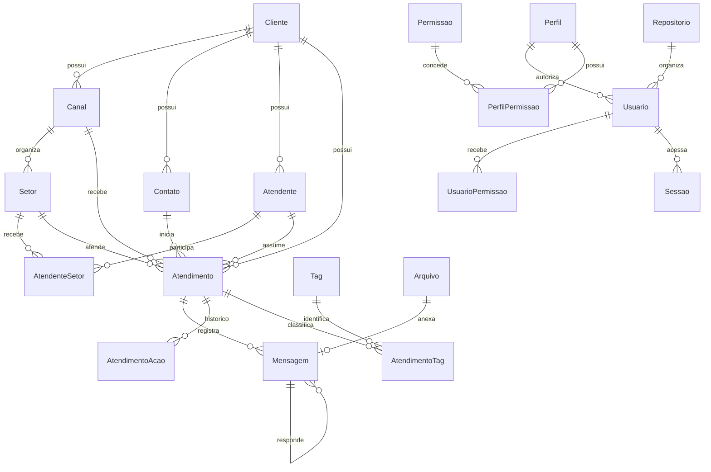

# Autentica e Zapiou na daFIRMA

A página `/` abre AssineAi, Zapiou e ADVai. O Trator de Assinaturas fica em `/assineai/trator`. O Zapiou fica em `/chat`, no padrão desse trator: abas dentro da tabela, menus por grupo, filtros no header, seleção e ações por registro. O duplo clique abre a conversa. Dá para expandir o chat sem menu lateral. Os dados daFIRMA ficam em `/firma`.

As telas usam HTML/Thymeleaf, CSS e JavaScript no servidor Java. O Chatwoot foi consultado como referência durante o desenvolvimento; seus arquivos não foram copiados para a aplicação.

## Fonte do contrato

O código examinado está em `/home/aluno/autentica/zapio`, cuja cópia em `/home/aluno/autentica/autentica/zapio` tem o mesmo conector e a mesma migração inicial. Foram usados:

- `model/sequelize/migrations`: 33 migrações do domínio de atendimento.
- `model/src/tabelas` e `model/src/database/connector.js`: campos, índices e associações de produção.
- `model/sequelize_AutenticaAI/migrations`: três migrações de identidade, incluindo `UsuarioPermissao`.
- `autenticaai/src/Tabelas` e `autenticaai/src/BancoDeDados/Conector.js`: usuários, perfis, permissões, repositórios e sessões.
- `model/src/AutenticaAI/CargaInicial`: perfis, permissões e seus vínculos.
- `model/src/routes/RotasSistema.js` e `model/src/enum/index.js`: módulos e valores de situação.

O contrato extraído contém **33 tabelas, 383 colunas, 57 chaves estrangeiras e 12 índices explícitos**, além das chaves primárias. Nomes e tipos seguem as migrações, completados pelos campos e índices dos modelos atuais. `createdAt` e as datas de eventos mantêm `TIMESTAMP WITH TIME ZONE`; não foram convertidos para `DATE`.

O manifesto [esquema.json](../src/main/resources/autentica/esquema.json) registra os campos, relações, índices e SHA-256 dos arquivos de origem. Não foram lidos arquivos de credenciais nem acessado o banco remoto de produção do Autentica. O contrato foi verificado contra o código disponibilizado, não contra um dump daquele banco.

## Relações principais



`AtendenteAutenticaAIUsuarioId` e `UsuarioClienteId` eram referências entre os dois bancos do Autentica, sem FK entre bancos. A aplicação valida esses vínculos, sem inventar uma FK no contrato extraído. As relações que já tinham FK mantêm o comportamento de exclusão e atualização da origem.

## Migrações e preservação dos dados

- **V25** cria `autentica` e `autentica_identidade`, preservando os nomes originais em namespaces distintos dos cadastros anteriores.
- **V26** copia os equivalentes existentes da FIRMA e cria `firma_autentica_vinculo`, com tabela/ID original, tabela/ID de destino, cliente e dados originais completos. UUIDs anteriores permanecem nas tabelas originais e no mapa; os registros do contrato Autentica usam IDs inteiros, conforme a origem.
- **V27** sincroniza inserções e atualizações dos serviços anteriores para as tabelas Autentica. O adaptador `EspelhoAutentica` mantém canais, contatos, setores, atendentes, atendimentos e mensagens compatíveis com os transportes existentes. Uma marca por transação impede recursão ou sobrescrita de dados canônicos pelo espelho.

As tabelas anteriores não são apagadas ou renomeadas. Campos que não têm equivalente no Autentica permanecem nelas e, nos registros copiados, em `dados_origem`. Valores textuais maiores que os limites de produção são ajustados somente na coluna de destino; o valor original completo permanece no mapa e na tabela anterior. Essa diferença deve ser considerada ao conferir uma migração com nomes longos.

O vínculo de `Empresas` (assinaturas) com `Cliente` usa documento/e-mail correspondentes; na instalação com uma única empresa anterior e uma única empresa de assinatura, usa esse vínculo único. Instalações com várias empresas sem documento/e-mail correspondentes mantêm clientes distintos, sem misturar seus registros por semelhança de nome. `firma_autentica_empresa` registra a associação e o repositório de identidade de cada conta. A edição de nome, documento e e-mail é refletida entre o cadastro canônico e o perfil de assinaturas.

O contrato original admite vários repositórios. Nesta aplicação cada conta tem seu repositório de identidade, para que alterações de perfis e permissões de uma empresa não alterem as demais. A carga de Administrador, Gestor, Atendente e suas permissões vem dos arquivos de carga inicial do Autentica.

## Operação disponível

- `/`: home original da FIRMA com os módulos.
- `/assineai/trator`: Trator existente, incluindo tabela, busca, seleção, exportação/importação e histórico das assinaturas.
- `/chat`: lista nativa de conversas, filas por situação, histórico, dados do contato, atribuição de atendente, transferência, finalização e envio pelo transporte existente.
- `/sistema?modulo=contatos`: cadastros e consultas do contrato de produção, com paginação, busca e seletores de relacionamentos da mesma empresa.
- Os menus incluem contatos, canais, atendentes, setores, atendentes por setor, tags, mensagens rápidas, templates, listas, disparos, chatbot, IA, integrações, webhooks, chaves, usuários, perfis, permissões, sessões, empresa e plano.
- Planos foram retirados da operação: a FIRMA é gratuita. Chaves podem ser emitidas/revogadas, sessões podem ser encerradas e disparos podem ser agendados, cancelados e retomados. Veja [as regras migradas, os executores e a configuração dos fornecedores](regras-autentica.md).
- O envio de conversa só retorna sucesso após confirmação do transporte. Sem ponte configurada, retorna erro; não grava uma confirmação fictícia. Os testes de navegador devem usar a ponte desabilitada, sem envio externo.

## Identidade e permissões

O acesso existente da empresa é mantido. Recuperação de usuários, alteração de senha, perfil próprio e revogação foram acrescentados ao Zapiou; detalhes em [regras-autentica.md](regras-autentica.md). O acesso pelo rodapé também aceita usuários de `autentica_identidade.Usuario` com a codificação original PBKDF2-HMAC-SHA256 (310.000 iterações, sal de 16 bytes, chave de 32 bytes, valores em Base64). O login anterior da empresa continua compatível com BCrypt. Nesse caso cria uma sessão em `Sessao`, respeita bloqueio, cliente ativo, perfil e permissões individuais. O logout marca a sessão como finalizada e o token deixa de ser aceito. Senhas, tokens de sessão e credenciais dos canais não aparecem nas consultas.

As operações administrativas verificam as permissões de leitura, inclusão e atualização do Autentica. Atendentes sem permissão de gestão acessam os canais, setores e atendimentos associados ao seu usuário. Os relacionamentos enviados em formulários são conferidos no servidor contra o cliente/repositório da sessão; trocar um `ClienteId` no payload não muda a empresa da operação.

## Reprodução e verificação

Para extrair novamente o esquema, sem conexão a banco e sem carregar configuração de credenciais:

```sh
AUTENTICA_ROOT=/home/aluno/autentica/zapio \
node scripts/autentica/extrair-esquema.cjs
python scripts/autentica/gerar-ponte.py
```

A extração precisa do Sequelize instalado na origem. Os artefatos gerados já ficam no projeto; executar a FIRMA não precisa do código Node do Autentica.

Testes Java:

```sh
./mvnw -q -Djava.awt.headless=true test
```

O teste de banco cria e apaga somente uma base descartável com nome aleatório. Aplica V1 a V24, insere uma cadeia de dados antigos, aplica V25 a V27 e verifica tabelas, colunas, FKs, vínculos, campos originais completos, datas e sincronização de callbacks:

```sh
FIRMA_TEST_POSTGRES_CONTAINER=firma-autentica-test-db \
FIRMA_TEST_POSTGRES_USER=firma_autentica \
FIRMA_TEST_POSTGRES_DB=firma_autentica \
python scripts/verificar-autentica.py
```

Para o navegador, inicie uma instância de teste em `18089`, usando PostgreSQL e Redis isolados, `SPRING_DOCKER_COMPOSE_ENABLED=false`, perfil `local-test`, segredo JWT local e `APP_CHAT_BRIDGE_KEY` vazio. O teste cria duas empresas e seus cadastros; não deve ser usado como teste de carga contra produção.

```sh
npm install --prefix /tmp/firma-browser playwright --no-audit --no-fund
NODE_PATH=/tmp/firma-browser/node_modules \
FIRMA_TEST_BASE_URL=http://127.0.0.1:18089 \
node src/test/js/autentica.browser.cjs
```

`CHROME_BIN` e `FIRMA_TEST_ARTIFACTS` permitem escolher o navegador e o diretório das capturas. O teste cobre a home com os três módulos, navegação por Zapiou/AssineAi/ADVai, identidade visual original nas outras telas, ausência de iframe, criação por formulário, relações, atendimento, erro de transporte desabilitado, isolamento entre empresas, login de atendente, permissões e revogação de sessão.
